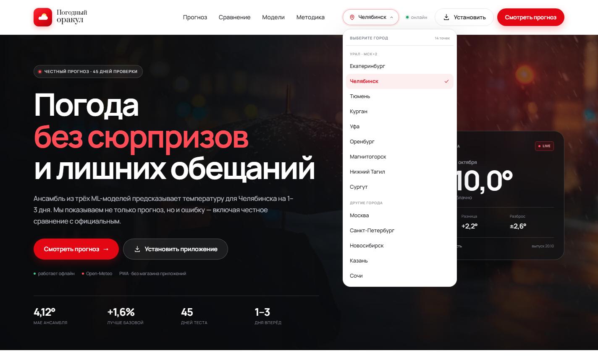

# Погодный оракул

Ансамбль из трёх ML-моделей, который предсказывает дневной максимум температуры
в 14 городах России до 14 дней вперёд по открытым данным Open-Meteo. С честным
хронологическим бэктестом, метриками MAE/RMSE и сравнением с архивом оперативных
прогнозов.

Города: **Урал (МСК+2)** — Екатеринбург, Челябинск, Тюмень, Курган, Уфа,
Оренбург, Магнитогорск, Нижний Тагил, Сургут; **другие** — Москва,
Санкт-Петербург, Новосибирск, Казань, Сочи.
Для каждого города обучается свой набор моделей и считается свой бэктест.

> **Короткий итог.** На семидневном горизонте ансамбль ошибается на **3,97 °C MAE**.
> Лучшая базовая модель (случайный лес, 3,92 °C) чуть точнее в среднем, но на
> горизонтах 1, 4 и 5 дней ансамбль выигрывает. Официальный прогноз Open-Meteo
> точнее — **1,56 °C**. Это не скрывается: проект показывает и сильные стороны
> ансамбля, и предел локальных моделей.

---

## Что внутри

| Компонент | Реализация |
|---|---|
| Данные | 365 дней факта + 92 дня архива прогнозов на каждый из 14 городов, Open-Meteo |
| Признаки | 40 признаков: лаги, скользящие статистики, давление, влажность, облачность, ветер, сезон |
| Модели | Линейная регрессия, случайный лес, градиентный бустинг |
| Горизонты | 1–14 дней — ML-ансамбль; официальный baseline доступен на 1–7 дней |
| Ансамбль | Веса выбираются только на validation; три стратегии на выбор |
| Города | 9 городов Урала (МСК+2) + Москва, Санкт-Петербург, Новосибирск, Казань, Сочи |
| Бэктест | Хронологический: train → validation → test, 45 дней теста |
| Метрики | MAE, RMSE, bias, R², парный cluster bootstrap по датам |
| Интерфейс | FastAPI + Jinja2 + PWA: отдельные страницы, поиск и геолокация города, период 7/10/14, карточки/список, слайдшоу, график, CSV, спортивные рекомендации |
| График | Матплотлиб: «прогноз vs факт» и сравнение моделей по MAE |

Модели обучаются с экспоненциальными весами свежести (период полураспада —
365 дней): свежая погода важнее для текущего режима.

### Приложение и оформление

Интерфейс переработан в устанавливаемое PWA. Визуальный язык взят с прошлого
сайта [LM Service](https://closed-star.vps.ktk-45.ru/): Golos Text и Cormorant Garamond,
красный акцент `#e30613`, тёмный фото-hero, крупная типографика, карточки,
пилюли-фильтры и модальные окна.

В шапке приложения — выбор из 14 городов, сгруппированных по регионам.
Разделы вынесены на отдельные страницы: `/forecast`, `/sport`, `/compare`,
`/models`, `/method`. При смене города текущая страница сохраняется.
В hero-блоке — автоматическое слайдшоу из трёх локальных фотографий с точками
переключения; оно отключается при `prefers-reduced-motion`.
В меню города есть поиск и определение ближайшего города по геолокации.
На странице прогноза — блок последних наблюдений, переключение «карточки / список»,
интерактивный SVG-график температуры и кнопка выгрузки выбранного периода в CSV.
Если Open-Meteo недоступен, приложение автоматически пробует публичную
страницу **Яндекс.Погоды** (до 13 дней вперёд: сегодняшний день не считается
прогнозом на будущее) и явно помечает источник. Если недоступны
оба источника, показывается сообщение об ошибке и кнопка «Повторить» —
без выдуманных значений. Страницы бэктеста, моделей и методики остаются доступны.
При смене города пересчитывается вся страница: живой прогноз, официальный
baseline, MAE, график и веса ансамбля.

Страница `/sport` превращает прогноз в практический ответ для спортсменов:
на каждый день считаются индекс комфорта, подходящие виды активности (бег,
велосипед, игровые виды, лыжи, коньки, плавание и другие — всего 12),
экипировка, состояние покрытия и предупреждения. Правила консервативные:
если источник не отдаёт осадки, вид, которому нужна сухая поверхность или
снег, не получает оценку «отлично». Если прогноз недоступен, страница честно
показывает ошибку и кнопку «Повторить».

Функции каталога тоже адаптированы: вместо услуг — карточки прогноза до 14 дней;
вместо онлайн-записи — модалка с составом ансамбля, официальным прогнозом и
кнопкой «Поделиться». Добавлены установка приложения, офлайн-режим, переключение
°C/°F и сохранение выбранных единиц. Онлайн-запись, авторизация и админка из
автосервиса в погодном проекте не нужны.

Установка: откройте сайт в Chrome/Edge и нажмите «Установить приложение».
На iPhone — «Поделиться» → «На экран „Домой“».




---

## Результаты бэктеста

Тест: **05.09.2026 — 19.10.2026**, 45 дат × 7 горизонтов = **315 прогнозов**
на каждый город. Все метрики — на общих датах, где доступен официальный прогноз.

| Город | Регион | Ансамбль, MAE | Лучшая базовая | Официальный | Улучшение |
|---|---|---:|---:|---:|---:|
| Санкт-Петербург | Другие | **2,12** | 2,18 | 1,13 | +2,8% |
| Сочи | Другие | **2,65** | 3,63 | 1,40 | +27,1% |
| Москва | Другие | **2,96** | 3,01 | 1,49 | +1,6% |
| Казань | Другие | **3,34** | 4,74 | 1,46 | +29,6% |
| Екатеринбург | Урал · МСК+2 | **3,97** | 3,92 | 1,56 | −1,1% |
| Нижний Тагил | Урал · МСК+2 | **4,14** | 4,17 | 1,78 | +0,9% |
| Челябинск | Урал · МСК+2 | **4,56** | 4,31 | 1,42 | −5,8% |
| Новосибирск | Другие | **4,73** | 4,91 | 1,28 | +3,6% |
| Уфа | Урал · МСК+2 | **4,78** | 5,13 | 1,55 | +7,0% |
| Тюмень | Урал · МСК+2 | **5,04** | 4,66 | 1,35 | −8,2% |
| Оренбург | Урал · МСК+2 | **5,37** | 5,49 | 1,39 | +2,1% |
| Магнитогорск | Урал · МСК+2 | **5,63** | 5,93 | 1,44 | +5,0% |
| Курган | Урал · МСК+2 | **5,64** | 4,54 | 1,41 | −24,3% |
| Сургут | Урал · МСК+2 | **9,22** | 5,28 | 1,30 | −74,9% |

В 9 из 14 городов ансамбль обошёл лучшую из трёх базовых моделей по MAE.
В Екатеринбурге, Челябинске, Тюмени, Кургане и Сургуте — не обошёл; это видно
в интерфейсе и не скрывается. Официальный прогноз Open-Meteo остаётся точнее
во всех городах.

Ниже — детальная таблица для Екатеринбурга (для остальных городов она
открывается в интерфейсе).

| Модель (Екатеринбург) | MAE, °C | RMSE, °C | bias, °C | n |
|---|---:|---:|---:|---:|
| Официальный Open-Meteo | **1,56** | 2,17 | 0,1 | 315 |
| Случайный лес | **3,92** | 5,11 | −0,1 | 315 |
| **Ансамбль** | 3,97 | 5,11 | 1,3 | 315 |
| Градиентный бустинг | 4,12 | 5,19 | −0,3 | 315 |
| Линейная регрессия | 4,73 | 5,88 | 3,8 | 315 |
| Инерция (последний факт) | 4,82 | 6,14 | 0,7 | 315 |

По горизонтам (Екатеринбург):

| Горизонт | Ансамбль, MAE | Лучшая из трёх базовых | Официальный |
|---|---:|---:|---:|
| 1 день | **3,08** | 3,21 (случайный лес) | 0,89 |
| 2 дня | 3,90 | **3,80** (случайный лес) | 1,03 |
| 3 дня | 4,32 | **3,96** (случайный лес) | 1,22 |
| 4 дня | **3,69** | 3,95 (случайный лес) | 1,43 |
| 5 дней | **3,89** | 4,24 (случайный лес) | 1,82 |
| 6 дней | 4,37 | **4,20** (случайный лес) | 2,07 |
| 7 дней | 4,53 | **4,09** (случайный лес) | 2,47 |

Что это значит:

- Ансамбль лучше леса на горизонтах 1, 4 и 5 дней.
- На 2, 3, 6 и 7 днях случайный лес немного точнее ансамбля.
- Официальный прогноз Open-Meteo существенно точнее на всех горизонтах.
  Такой результат тоже защищаем: пайплайн не подгоняет сравнение и не выбирает
  удобный период.

Парный bootstrap по датам для разницы MAE «ансамбль − официальный»:
**+2,41 °C**, 95% ДИ **1,63…3,29 °C**, вероятность того, что ансамбль лучше
на этом периоде, — **0%**. Это не случайный проигрыш, а разница в классе модели.

---

## Почему официальный прогноз точнее

Open-Meteo Previous Runs — это архив выходов глобальной численной модели,
которая усваивает данные станций, спутников, радиозондов и авиации. Наша модель
видит только локальный временной ряд и не знает о приближающемся фронте, пока
он не проявится в лагах.

Есть и важная оговорка: для недавних дат и факт, и архив прогноза Open-Meteo
могут опираться на близкие модельные источники. Это может завышать качество
официального baseline. Поэтому сравнение стоит читать как **сильный ориентир**,
а не как чистый эксперимент против Росгидромета. В README и интерфейсе это
названо прямо.

---

## Быстрый старт

Требуется Python 3.11+.

Зависимости уже установлены в локальную `.vendor`, данные и обученные модели
лежат в репозитории. Самый короткий путь:

```powershell
.\run.cmd
```

`run.cmd` — основной способ: он обходит политику выполнения PowerShell и сам
поднимает Uvicorn. Если политика разрешает скрипты, можно запускать напрямую:

```powershell
.\run.ps1
```

Откройте <http://127.0.0.1:8000>. Swagger — <http://127.0.0.1:8000/docs>.

Если `.vendor` нет, установите окружение:

```powershell
.\setup.cmd
.\run.cmd
```

Или вручную:

```powershell
python -m venv .venv
.\.venv\Scripts\Activate.ps1
pip install -r requirements.txt
python -m uvicorn app.main:app --reload --port 8000
```

### Windows EXE

Готовая portable-версия лежит здесь:

```text
dist\WeatherOracle\WeatherOracle.exe
```

Запустите `WeatherOracle.exe` двойным щелчком. Появится splash-экран,
затем отдельное окно приложения без адресной строки и вкладок браузера.
Внутри EXE поднимается локальный FastAPI-сервер, а окно показывает
Chrome в режиме установленного приложения (если Chrome нет — используется Edge).
Выбор города находится в шапке приложения.

Важно: переносите/копируйте **всю папку** `WeatherOracle`, а не один `.exe`.
Рядом должна оставаться папка `_internal`. Папку `userdata` удалять не нужно:
в ней хранятся логи и обновляемые данные, она переносится вместе с программой.
На флешке программа остаётся portable: путь к данным вычисляется от EXE.

При первом запуске данные копируются из `_internal` в `userdata/data`, поэтому
программа не пытается писать в защищённую папку `_internal`. Если Open-Meteo
доступен, история автоматически обновляется; прогноз также обновляется
каждые 15 минут и при появлении сети. Если Open-Meteo недоступен, используется
Яндекс.Погода (с явной пометкой источника); если недоступны оба — сообщение об
ошибке и кнопка «Повторить», без подстановки недостоверного прогноза.

Первый запуск занимает 15–60 секунд: распаковываются Python-модули,
копируются данные и загружаются модели. EXE не подписан сертификатом,
поэтому SmartScreen может показать предупреждение:
«Подробнее» → «Выполнить в любом случае».

Пересобрать EXE:

```powershell
.\build.cmd
```

Для сборки нужен PyInstaller (ставится в `.buildtools`), сами модели и
зависимости из `.vendor`. Промежуточные файлы PyInstaller складываются в
`.cache/pyinstaller`, поэтому папка `build/` больше не создаётся: раньше в ней
оставался похожий на вид `WeatherOracle.exe`, запуск которого давал ошибку
«Failed to load Python DLL … python313.dll». Запускать нужно только
`dist\WeatherOracle\WeatherOracle.exe`. Сборка сама проверяет результат
(`--smoke-test`) и сохраняет `userdata` от предыдущей версии.

### Пересобрать данные и модели

```powershell
# 1. Скачать год факта и 92 дня архива прогнозов по всем городам
python scripts\fetch_data.py

# 2. Обучить 3 модели × 14 горизонтов × 14 городов, ансамбли и метрики
python scripts\train.py

# 3. Запустить интерфейс
.\run.cmd
```

Один город можно пересобрать отдельно:

```powershell
python scripts\fetch_data.py --city moscow
python scripts\train.py --city moscow
```

`fetch_data.py` по умолчанию берёт период «год назад — вчера» и не тянет
неполный текущий день. Дата окончания и длина истории настраиваются:

```powershell
python scripts\fetch_data.py --days 365 --end 2026-10-19
```

---

## Методика без утечек

### Целевая переменная

Дневной максимум температуры на 2 м (`temperature_2m_max`), °C. MVP
сфокусирован на температуре; осадки, влажность, давление и облачность
используются как предикторы, а не как отдельная цель.

### Признаки

Для целевой даты `t` и горизонта `h` прогноз считается выпущенным в 00:00 дня
`t − h`. Последний полностью известный день — `t − h − 1`. Поэтому все лаги
начинаются со сдвига `h + 1`, а не с сегодняшнего значения. Это исключает
подглядывание в целевую дату.

40 признаков:

- лаги `tmax` 1–7, `tmin` 1–3, осадков 1–3;
- скользящие средние и std за 3/7/14 дней, тренды на 3 и 7 дней;
- суточная амплитуда, флаг заморозка;
- давление и его изменение за 3/7 дней;
- влажность, облачность, точка росы и её дефицит, радиация, ветер;
- направление ветра через sin/cos;
- сезонные синусоиды (1-я и 2-я гармоники).

### Разбиение

```
04.11.2025 — 05.08.2026   обучение (первый месяц истории нужен для лагов)
06.08.2026 — 04.09.2026   validation: выбор весов ансамбля
05.09.2026 — 19.10.2026   test: только финальные метрики
```

Тест не использовался ни для обучения, ни для выбора гиперпараметров, ни для
подбора весов. Перемешивания нет: модель всегда учится на прошлом и проверяется
на будущем.

### Ансамбль

На validation сравниваются три стратегии:

1. равные веса;
2. веса, обратные MAE;
3. неотрицательные веса, минимизирующие MAE (сетка с шагом 0,02).

Выбирается стратегия с лучшим validation MAE, затем фиксируется. На тесте
веса уже не меняются. Финальные веса по горизонтам:

| h | Линейная | Лес | Бустинг |
|---|---:|---:|---:|
| 1 | 26% | 74% | 0% |
| 2 | 2% | 20% | 78% |
| 3 | 0% | 100% | 0% |

### Метрики

```
MAE  = mean(|ŷ − y|)
RMSE = sqrt(mean((ŷ − y)²))
bias = mean(ŷ − y)
```

Дополнительно считается 95% доверительный интервал разницы MAE с официальным
прогнозом через парный bootstrap по датам (3 000 ресемплов). Ресемплируется
целая дата со всеми семью горизонтами, чтобы сохранить корреляцию внутри дня.

---

## API

| Метод | Путь | Назначение |
|---|---|---|
| GET | `/` | HTML-интерфейс; `?city=moscow` — выбранный город |
| GET | `/api/health` | Статус, число моделей и загруженных городов |
| GET | `/api/cities` | Список городов и их headline-метрики |
| GET | `/api/metrics?city=moscow` | Полные метрики города |
| GET | `/api/backtest?city=moscow&lead=1&model=ensemble` | Ряды «факт vs прогноз» |
| GET | `/api/forecast?city=moscow` | Живой прогноз до 14 дней; официальный baseline на 1–7 |
| GET | `/api/forecast?city=moscow&refresh=true` | Принудительно обновить кэш |
| GET | `/api/sport?city=moscow` | Спортивные рекомендации по дням: комфорт, виды, экипировка |
| GET | `/manifest.webmanifest` | Манифест PWA |
| GET | `/service-worker.js` | Service worker для офлайн-режима |
| GET | `/docs` | Swagger UI |

Пример ответа живого прогноза:

```json
{
  "city": "ekaterinburg",
  "location": {"name": "Екатеринбург"},
  "issue_date": "2026-10-20",
  "rows": [
    {
      "date": "2026-10-21",
      "lead": 1,
      "ensemble_tmax": 8.6,
      "model_spread": 0.8,
      "official_tmax": 6.5,
      "precip_mm": 0.0
    }
  ]
}
```

Живой прогноз кэшируется на 15 минут. Если Open-Meteo недоступен, интерфейс
пробует Яндекс.Погоду и помечает её как источник. Если недоступны оба источника,
показывается ошибка, но страница с результатами бэктеста остаётся рабочей.
Service worker сохраняет оболочку и последний успешный ответ `/api/forecast`
и `/api/sport`,
поэтому установленное приложение открывается и без сети.

---

## Структура проекта

```
.
├── app/
│   ├── config.py          пути, константы, локация
│   ├── data.py            загрузка и парсинг Open-Meteo
│   ├── features.py        40 признаков, хронологические сплиты
│   ├── models.py          модели, веса ансамбля, метрики, bootstrap
│   ├── training.py        обучение, бэктест, сохранение артефактов
│   ├── reporting.py       график «прогноз vs факт»
│   ├── service.py         загрузка моделей и живой прогноз
│   ├── sport.py           спортивные рекомендации по погоде
│   ├── main.py            FastAPI-приложение
│   ├── templates/         HTML-интерфейс
│   └── static/            CSS, JS, шрифты, hero-фото, иконки, manifest, SW
├── scripts/
│   ├── fetch_data.py      загрузка года данных
│   └── train.py           обучение и оценка
├── data/
│   └── cities/<город>/
│       ├── actuals.csv
│       ├── official_forecasts.csv
│       └── *_meta.json
├── artifacts/
│   ├── <город>/
│   │   ├── metrics.json
│   │   ├── predictions.csv
│   │   └── forecast_vs_fact.png
│   ├── models/<город>/lead_1..3.joblib
│   └── app-overview.png
├── build_assets/
│   ├── splash.png         экран загрузки EXE
│   └── README-dist.txt    инструкция внутри папки с EXE
├── desktop.py             запуск как Windows-приложение
├── WeatherOracle.spec     конфигурация PyInstaller
├── build.ps1 / build.cmd  сборка EXE
├── dist/WeatherOracle/    готовая portable-версия
├── tests/
├── requirements.txt
├── requirements-build.txt
├── setup.ps1
├── setup.cmd
├── run.ps1
└── run.cmd
```

---

## Тесты

```powershell
python -m unittest discover -s tests -v
```
Проверяется главное:

- признаки целевой даты не зависят от фактической температуры этой даты;
- последний известный день отстоит от цели на `h + 1`;
- будущие строки считаются только по истории;
- сплиты идут строго по времени;
- веса оптимизируются и нормируются;
- bootstrap находит более точную модель;
- спортивные рекомендации не советуют лыжи без данных о снеге и не ставят
  «отлично» видам, которым нужна сухая поверхность, при неизвестных осадках.

---

## Ограничения

Подробная карточка модели: [MODEL_CARD.md](MODEL_CARD.md).
1. **14 точек.** Модели обучены для 14 городов; это не глобальный сервис.
   Для нового города нужно скачать историю и переобучить модели.
2. **Короткий тест.** 45 дней — один-два режима погоды. MAE может заметно
   измениться на другом сезоне.
3. **Один провайдер.** Факт и официальный baseline — Open-Meteo. Для более
   строгого сравнения нужен независимый источник фактической температуры.
4. **Детерминированный прогноз.** Ансамбль даёт точечную оценку; разброс между
   базовыми моделями показывается в интерфейсе, но это не калиброванный
   вероятностный интервал.
5. **Не оперативный прогноз.** Проект учебный; не используйте его для
   авиации, безопасности или сельского хозяйства.

---

## Что говорить на защите

1. **Проблема:** прогноз температуры — это регрессия на временном ряду, где
   легко случайно залезть в будущее.
2. **Решение:** строгая схема `t − h − 1`, хронологические train/validation/test
   и веса ансамбля, выбранные только на validation.
3. **Результат:** ансамбль даёт 3,97 °C MAE на семи горизонтах; на h=1, 4 и 5
   он лучше случайного леса, но официальный Open-Meteo точнее на всех горизонтах.
4. **Честность:** официальный Open-Meteo точнее (1,56 °C), и это показано
   в интерфейсе, README и API. Проект не выдаёт желаемое за действительное.
5. **Инженерия:** данные скачиваются и кэшируются, модели версионируются,
   метрики воспроизводимы, сервис отдаёт и бэктест, и живой прогноз.

---

## Источники

- [Open-Meteo Archive API](https://open-meteo.com/en/docs/historical-weather-api) — фактическая погода (ERA5 / best match).
- [Open-Meteo Previous Runs API](https://open-meteo.com/en/docs/previous-runs-api) — архив оперативных прогнозов для baseline.
- [Open-Meteo Forecast API](https://open-meteo.com/en/docs) — прогноз на будущее.
- [Яндекс.Погода](https://yandex.ru/pogoda/) — резервный публичный источник оперативного прогноза.
- [scikit-learn](https://scikit-learn.org/) — модели и метрики.
- [FastAPI](https://fastapi.tiangolo.com/) — API и Swagger.

Проект не аффилирован с Open-Meteo. Данные используются по открытой лицензии
провайдера; при публикации результатов указывайте источник.

Лицензии шрифтов и фотографии: [THIRD_PARTY_NOTICES.md](THIRD_PARTY_NOTICES.md).
